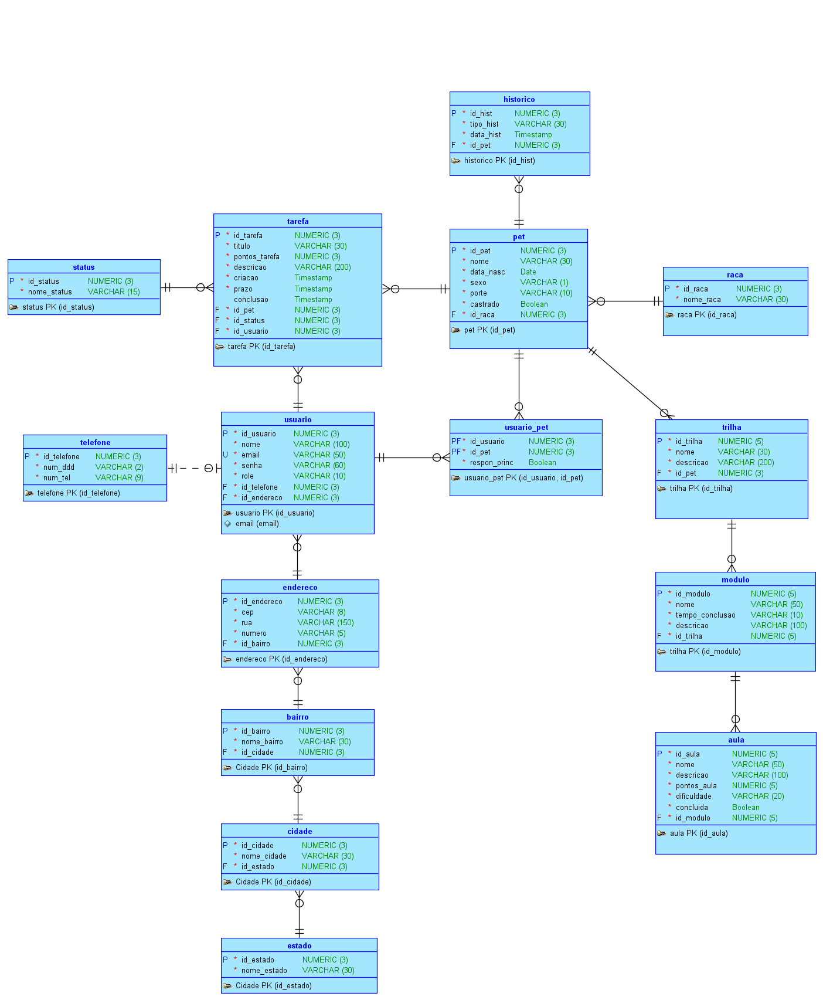

# Database-Advanced — 🐾 PetGuardian
> Engenharia de Banco de Dados Relacional em 3FN, Empacotamento de Processos em Packages (`PKG_PETGUARDIAN`), Rotinas de Exportação NoSQL, Persistência Poliglota com MongoDB Atlas e Governança do Care Circle — Challenge Clyvo 2026 — Turma 2TDSPG.

---

## 👥 Integrantes

| Nome | RM | Turma | GitHub | LinkedIn |
| :--- | :---: | :---: | :--- | :--- |
| **Enzo Okuizumi** | **561432** | 2TDSPG | [EnzoOkuizumiFiap](https://github.com/EnzoOkuizumiFiap) | [Enzo Okuizumi](https://www.linkedin.com/in/enzo-okuizumi-b60292256/) |
| **Gustavo Okada** | **563428** | 2TDSPG | [Gdev3356](https://github.com/Gdev3356) | [Gustavo Okada](https://www.linkedin.com/in/gustavo-okada-53a3b8359/) |
| **Lucas Barros Gouveia** | **566422** | 2TDSPG | [LuzBGouveia](https://github.com/LuzBGouveia) | [Lucas Barros Gouveia](https://www.linkedin.com/in/lucas-barros-gouveia-09b147355/) |
| **Luna de Carvalho Guimarães** | **562290** | 2TDSPG | [lunaguima](https://github.com/lunaguima) | [Luna M. Guimarães](https://www.linkedin.com/in/luna-m-guimar%C3%A3es-1850ab173/) |
| **Milton Marcelino** | **564836** | 2TDSPG | [MiltonMarcelino](https://github.com/MiltonMarcelino) | [Milton Marcelino](http://linkedin.com/in/milton-marcelino-250298142) |

---

## 🔗 Links Oficiais de Entrega

* **Repositório GitHub:** [https://github.com/Challenge-Pet-Guardian-4/Database-Advanced](https://github.com/Challenge-Pet-Guardian-4/Database-Advanced)
* **Documentação Técnica PDF:** [`Documentação Database Advanced Sprint 4 - Pet Guardian.pdf`](./docs/Documenta%C3%A7%C3%A3o%20Database%20Advanced%20Sprint%204%20-%20Pet%20Guardian.pdf)
* **Projeto Oracle Data Modeler:** [Pasta `data modeler/`](./data%20modeler) (arquivos `challenge.dmd` e `challenge.ddl`)
* **Script SQL Relacional (DDL 3FN + Carga de Dados):** [`2TDSPG_2026_CodigoSql_PetGuardian.sql`](./2TDSPG_2026_CodigoSql_PetGuardian.sql)
* **Script de Empacotamento PL/SQL (Packages e Exportação JSON):** [`sprint4_pkg_petguardian.sql`](./sprint4_pkg_petguardian.sql)
* **Pasta de Artefatos NoSQL MongoDB:** [`mongodb/`](./mongodb)
  * **Dataset Exportado das Aulas Relacionais:** [`aulas_dataset.json`](./mongodb/aulas_dataset.json)
  * **Dataset Educacional NoSQL (Markdown Rico):** [`conteudos_dataset.json`](./mongodb/conteudos_dataset.json)
  * **Script NoSQL — Coleção `aulas`:** [`setup_mongodb_aulas.js`](./mongodb/setup_mongodb_aulas.js)
  * **Script NoSQL — Coleção `conteudos_aula`:** [`setup_mongodb_conteudos.js`](./mongodb/setup_mongodb_conteudos.js)
* **Vídeo Demonstrativo da Execução (YouTube):** *[Link do YouTube a ser anexado]*

---

## 🎯 Rastreabilidade dos Requisitos da Sprint 4

| Requisito | Descrição Oficial da Sprint 4 | Peso | Onde Encontrar | Status |
| :--- | :--- | :---: | :--- | :---: |
| **1. Modelo Relacional Normalizado** | Modelo 3FN coerente com a proposta de valor Clyvo, sem redundâncias e com integridade referencial estrita. | 20 pts | Diagramas em `docs/` e tabelas no [`2TDSPG_2026_CodigoSql_PetGuardian.sql`](./2TDSPG_2026_CodigoSql_PetGuardian.sql) | Concluído |
| **2. Empacotamento de Processos (Packages)** | Procedimentos, funções e trigger personalizada (`TRG_AUDIT_TAREFA`) integrados no pacote PL/SQL (`PKG_PETGUARDIAN`), com controle de transação e tratamento de exceções padronizadas. | 25 pts | [`sprint4_pkg_petguardian.sql`](./sprint4_pkg_petguardian.sql) | Concluído |
| **3. Exportação do Dataset JSON** | Procedimento em pacote PL/SQL (`pr_exportar_aulas_json`) e dataset estruturado em JSON exportado a partir de dados reais de `AULA`. | 20 pts | [`sprint4_pkg_petguardian.sql`](./sprint4_pkg_petguardian.sql) e [`mongodb/aulas_dataset.json`](./mongodb/aulas_dataset.json) | Concluído |
| **4. Estrutura e Carga no MongoDB** | Código MongoDB com criação de coleções (`aulas` e `conteudos_aula`), validação de schema (`$jsonSchema`), índices e ingestão dos datasets. | 25 pts | [`mongodb/setup_mongodb_aulas.js`](./mongodb/setup_mongodb_aulas.js) e [`mongodb/setup_mongodb_conteudos.js`](./mongodb/setup_mongodb_conteudos.js) | Concluído |
| **5. Vídeo Demonstrativo** | Vídeo explicando o funcionamento das packages e a estrutura do MongoDB. | 10 pts | Link no README (YouTube) | Em gravação |

---

## 📐 Modelagem Lógica e Relacional do Banco de Dados

### Modelo Lógico


### Modelo Relacional (Físico)


---

## 💡 Contexto da Solução e Decisões de Engenharia

Seguindo as diretrizes estratégicas da **Mentoria Clyvo 2026**, o ecossistema de dados foi desenhado com base em princípios sólidos de engenharia de software e banco de dados:

1. **Descontinuação do Modelo Clínico Legado:** Foram eliminadas as tabelas legadas de prontuário veterinário comercial (`veterinario`, `clinica`, `atendimento`, `tipo_atend`), concentrando o domínio na **governança preventiva familiar e na rotina diária**.
2. **O Animal no Centro do Domínio (`PET`):** O indivíduo animal é a entidade nuclear. Tarefas, histórico preventivo, trilhas educativas e pontuação convergem para ele.
3. **Care Circle Familiar (`USUARIO_PET`):** Modelagem N:M entre tutores e pets com identificador explícito de tutor titular (`respon_princ = 1`), permitindo cotutela familiar e compartilhamento de rotina.
4. **Índice Condicional de Titularidade Única:** Garantia física no banco de dados de que cada pet possui no máximo **um** tutor principal ativo:
   ```sql
   CREATE UNIQUE INDEX uq_usuario_pet_principal ON usuario_pet (CASE WHEN respon_princ = 1 THEN pet_id_pet END);
   ```
5. **Gamificação Pet-Centric da Rotina (`TAREFA` e `STATUS`):** As tarefas são executadas *para* o pet e a pontuação pertence ao pet. Todos os co-cuidadores visualizam e alimentam o mesmo score consolidado.
6. **Desacoplamento Semântico de Status:** Eliminação total de IDs mágicos hardcoded no PL/SQL. As queries resolvem status dinamicamente por nome (`status.nome_status = 'CONCLUIDO'` e `'PENDENTE'`).
7. **Arquitetura Dual no MongoDB:**
   - **Coleção `aulas`:** Metadados estruturados exportados diretamente da tabela relacional `AULA` do Oracle via `JSON_ARRAYAGG` + `JSON_OBJECT`.
   - **Coleção `conteudos_aula`:** Conteúdos pedagógicos ricos em formato Markdown, com links de apoio multimídia, armazenados nativamente no NoSQL.
   - **Vínculo Lógico:** Relacionamento desacoplado através do campo `aula_id` referenciando `AULA.id_aula`. Trata-se de uma associação lógica em nível de aplicação, não uma foreign key física do MongoDB.

---

## 📦 Especificação Técnica da Package `PKG_PETGUARDIAN`

A package centraliza todas as regras de negócio analíticas, gamificadas e transacionais da aplicação:

### Seção 1: Pontuação Gamificada de Pets e Usuários
* **`pr_calcular_pontuacao_pet` (Procedure):**  
  Calcula a pontuação consolidada do **Pet individual**, somando as tarefas concluídas (via join com `status` onde `nome_status = 'CONCLUIDO'`) e as aulas finalizadas das suas trilhas e módulos. Os co-cuidadores compartilham o mesmo total de pontos do animal.  
  *Consumo Java/App:* `GET /pets/{id}/pontuacao`
* **`pr_calcular_pontuacao_usuario` (Procedure):**  
  Calcula a pontuação agregada de todos os pets sob tutela do usuário através de `USUARIO_PET`. Utilizada como métrica de engajamento do cuidador.  
  *Consumo Java/App:* `GET /pets/pontuacao/me`
* **`pr_obter_resumo_rede_cuidado` (Procedure):**  
  Gera o relatório consolidado da rede de cuidado do usuário em uma única chamada: total de pets, total de cuidadores, tarefas pendentes, tarefas concluídas e pontos acumulados.  
  *Consumo Java/App:* `GET /usuarios/me/rede-cuidado`
* **`fn_obter_nivel_usuario` (Function):**  
  Retorna o nível de engajamento do tutor com base no somatório consolidado dos pets que cuida:
  * `0` a `50 pts`  ➜ **`BRONZE`**
  * `51` a `150 pts` ➜ **`PRATA`**
  * `151+ pts`       ➜ **`OURO`**

### Seção 2: Operações Transacionais, Auditoria e Exportação JSON
* **`pr_transferir_responsavel_principal` (Procedure):**  
  Transação atômica que garante a transferência de titularidade sobre o pet sem permitir estados intermediários inconsistentes ou múltiplos titulares, utilizando atualização condicional em instrução única.  
  *Consumo Java/App:* `PATCH /pets/{id}/responsavel-principal`
* **`pr_registrar_auditoria_tarefa` (Procedure):**  
  Gravação modularizada na tabela `AUDITORIA_DML_TAREFA`.
* **`pr_exportar_aulas_json` (Procedure):**  
  Exportação nativa do dataset da tabela relacional `AULA` em formato JSON (`CLOB`) serializado com funções analíticas nativas do Oracle 19c (`JSON_SERIALIZE` + `JSON_ARRAYAGG` + `JSON_OBJECT`). Permite a extração programática dos dados para ingestão no MongoDB diretamente via chamada PL/SQL.
* **`trg_audit_tarefa` (Trigger):**  
  Trigger de linha (`FOR EACH ROW`) disparada automaticamente após `INSERT`, `UPDATE` ou `DELETE` na tabela `TAREFA`. Delega a persistência dos dados para a procedure empacotada.

### Tabela de Tratamento de Exceções Padronizadas

| Código ORA | Identificador PL/SQL | Descrição / Causa Raiz |
| :---: | :--- | :--- |
| `-20018` | `e_id_invalido` | Identificador nulo, negativo ou zerado passado como argumento. |
| `-20019` | `e_pet_inexistente` | Pet não localizado na base relacional para o ID informado. |
| `-20020` | Genérico Pet Score | Falha inesperada durante a agregação de pontos do pet. |
| `-20022` | `e_usuario_inexistente` | Usuário não localizado na base relacional para o ID informado. |
| `-20023` | Genérico User Score | Falha inesperada durante a agregação de pontos do usuário. |
| `-20024` | Genérico Care Circle | Falha inesperada ao consolidar métricas da rede de cuidado. |
| `-20025` | Genérico User Level | Erro inesperado ao classificar o nível de gamificação do usuário (`fn_obter_nivel_usuario`). |
| `-20041` | `e_vinculo_inexistente` | Novo responsável não possui vínculo prévio com o animal em `USUARIO_PET`. |
| `-20042` | Genérico Transferência | Erro durante a transferência de responsabilidade principal. |
| `-20043` | Genérico Auditoria | Erro durante a gravação de log de auditoria da tarefa. |
| `-20044` | Genérico Exportação JSON | Erro durante a extração e serialização do dataset JSON de aulas (`pr_exportar_aulas_json`). |

---

## 🍃 Persistência Poliglota & Coleções MongoDB

O banco `petguardian` no MongoDB Atlas opera com duas coleções complementares:

### 1. Coleção `aulas` (Metadados Relacionais Exportados)
Originada da exportação direta da tabela `AULA` do Oracle 19c (`PKG_PETGUARDIAN.pr_exportar_aulas_json` em `sprint4_pkg_petguardian.sql` ➜ `mongodb/aulas_dataset.json`):

```json
{
  "_id": "ObjectId('...')",
  "id_aula": 1,
  "nome": "Introdução ao Clicker",
  "descricao": "Fundamentos de marcação positiva",
  "pontos_aula": 50,
  "dificuldade": "INICIANTE",
  "concluida": 1,
  "modulo_id_modulo": 1
}
```

* **Índices:**
  - `idx_id_aula_unique` (`{ "id_aula": 1 }`, `unique: true`): Chave primária de origem relacional.
  - `idx_modulo_id_modulo` (`{ "modulo_id_modulo": 1 }`): Filtro por módulo pedagógico.
  - `idx_dificuldade` (`{ "dificuldade": 1 }`): Busca por nível de dificuldade.

### 2. Coleção `conteudos_aula` (Conteúdo Pedagógico Rico em Markdown)
Armazena materiais didáticos detalhados, passos práticos e links multimídia gerenciados no NoSQL (`conteudos_dataset.json`):

```json
{
  "_id": "ObjectId('...')",
  "aula_id": 1,
  "tipo_conteudo": "PASSO_A_PASSO",
  "corpo_markdown": "# Introdução ao Clicker\n\nFundamentos de marcação positiva utilizando o método de indução positiva com petisco.\n\n### Passo a Passo:\n1. Carregue o clicker com petisco de alto valor.\n2. Clique no exato instante em que o cão oferecer a resposta desejada.\n3. Entregue o petisco em até 2 segundos para fixação cognitiva.\n\n> **Dica de Ouro:** Repita em sessões de no máximo 3 minutos para não causar estresse cognitivo.",
  "links_recursos": [
    "https://www.akc.org/expert-advice/training/clicker-training-your-dog-mark-and-reward/",
    "https://en.wikipedia.org/wiki/Clicker_training"
  ],
  "atualizado_em": "2026-10-08T18:00:00Z"
}
```

* **Índices:**
  - `idx_aula_id_unique` (`{ "aula_id": 1 }`, `unique: true`): Vínculo lógico com a aula.
  - `idx_busca_textual_conteudo` (`{ "corpo_markdown": "text" }`): Busca textual completa.
  - `idx_tipo_conteudo` (`{ "tipo_conteudo": 1 }`): Filtro por formato (`ARTIGO`, `VIDEO`, `PASSO_A_PASSO`).

---

## 🚀 Guia Passo a Passo de Execução

### Opção 1: Execução no Oracle Database (SQL Developer / SQLcl / VS Code)

1. **Passo 1 — Carga DDL e Sementes Relacionais:**
   * Abra e execute o arquivo [`2TDSPG_2026_CodigoSql_PetGuardian.sql`](./2TDSPG_2026_CodigoSql_PetGuardian.sql).
   * Ele realiza a limpeza segura e idempotente, cria as 15 tabelas em 3FN + tabela de auditoria, constraints, índices secundários e insere as sementes válidas com `COMMIT`.

2. **Passo 2 — Empacotamento PL/SQL, Testes e Exportação JSON:**
   * Abra e execute o arquivo [`sprint4_pkg_petguardian.sql`](./sprint4_pkg_petguardian.sql).
   * Compila a especificação e corpo de `PKG_PETGUARDIAN`, a trigger `TRG_AUDIT_TAREFA` e dispara a bateria de testes demonstrativos (Testes 1 a 6) com rollback limpo.
   * O **Teste 6** invoca diretamente `PKG_PETGUARDIAN.pr_exportar_aulas_json` para demonstrar a extração nativa em JSON das aulas relacionais.
   * *(Opcional)* Para regerar o arquivo físico `mongodb/aulas_dataset.json` via Oracle SQL Developer usando SPOOL:
     ```sql
     SET SERVEROUTPUT ON SIZE UNLIMITED;
     SET LINESIZE 32767;
     SET LONG 100000;
     SET PAGESIZE 0;
     SET FEEDBACK OFF;
     SET HEAD OFF;
     SPOOL "<caminho_do_repositorio>/Database-Advanced/mongodb/aulas_dataset.json";
     DECLARE
         v_json CLOB;
     BEGIN
         pkg_petguardian.pr_exportar_aulas_json(v_json);
         DBMS_OUTPUT.PUT_LINE(v_json);
     END;
     /
     SPOOL OFF;
     ```

---

### Opção 2: Carga do MongoDB via Mongosh ou Compass

Todos os artefatos NoSQL residem na pasta [`mongodb/`](./mongodb).

Execute no terminal:

```bash
# Navegar até a pasta NoSQL
cd mongodb

# 1. Carga da coleção 'aulas' (metadados relacionais exportados)
mongosh "mongodb+srv://<usuario>:<senha>@cluster0.p7100.mongodb.net/petguardian" setup_mongodb_aulas.js

# 2. Carga da coleção 'conteudos_aula' (conteúdo pedagógico rico)
mongosh "mongodb+srv://<usuario>:<senha>@cluster0.p7100.mongodb.net/petguardian" setup_mongodb_conteudos.js
```

Ou no **MongoDB Compass**:
1. Conecte ao cluster e abra a aba inferior **`>_MONGOSH`**.
2. Aponte para a pasta `mongodb/` e execute os scripts:
   ```javascript
   process.chdir("<caminho_do_repositorio>/Database-Advanced/mongodb")
   load("setup_mongodb_aulas.js")
   load("setup_mongodb_conteudos.js")
   ```
3. O console confirmará a criação das coleções, aplicação do `$jsonSchema`, índices e contagem de documentos inseridos.

---

## 🧪 Evidências de Teste da `PKG_PETGUARDIAN`

Ao executar o script de testes de [`sprint4_pkg_petguardian.sql`](./sprint4_pkg_petguardian.sql), os seguintes resultados são emitidos no `DBMS_OUTPUT`:

```text
=== TESTE 1: pr_calcular_pontuacao_pet ===
Thor (ID 1) -> Tarefas: 5 | Aulas: 120 | Total: 125

=== TESTE 2: pr_calcular_pontuacao_usuario e fn_obter_nivel_usuario ===
Carlos Silva (ID 1) -> Tarefas: 13 | Aulas: 120 | Total: 133
Nível de Gamificação do Tutor (FUNCTION): PRATA

=== TESTE 3: pr_obter_resumo_rede_cuidado (Carlos Silva ID 1) ===
Carlos Silva (ID 1) -> Pets: 2 | Cuidadores: 1 | Tarefas Pendentes: 2 | Tarefas Concluídas: 2 | Pontos Acumulados: 133

=== TESTE 4: pr_transferir_responsavel_principal ===
Titularidade de Thor transferida com sucesso para Lucas Mendes (ID 5).

=== TESTE 5: Disparo da Trigger trg_audit_tarefa na Tabela TAREFA ===
Tarefa ID 2 atualizada com sucesso. Registro de auditoria gerado pela trigger:
ID_AUDITORIA: 1 | NOME_USUARIO: RM561432 | TIPO_OPERACAO: UPDATE | VALORES_OLD: ID_TAREFA=2; TITULO=Medicamento Antibiótico; PONTOS=10; STATUS=1; PET=1; USUARIO=1 | VALORES_NEW: ID_TAREFA=2; TITULO=Medicamento Antibiótico; PONTOS=10; STATUS=2; PET=1; USUARIO=1

=== TESTE 6: pr_exportar_aulas_json (Empacotamento do Dataset JSON) ===
Dataset JSON exportado com sucesso (1434 caracteres).
```
